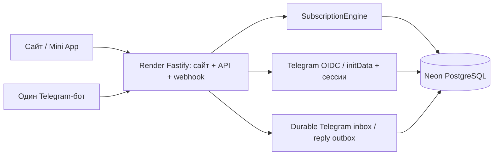

# Архитектура Stage 1.2

Расширяется monorepo Stage 1.1.1. Пакеты shared/runtime/database/providers и
прежняя миграция сохранены. WebDemo служит визуальной основой: CSS, палитра,
карточки, темы, сетка и адаптивность. Локальная модель WebDemo не переносится:
в браузере нет собственных пользователей, заказов или серверов.

`engine.ts` обслуживает HTTP и webhook через один серверный сервис. Бот не
делает петлю HTTP-запросов к собственному процессу: его webhook-контроллер
вызывает тот же слой приложения с проверенной Telegram identity. Это единый
Backend, общая авторизация пользователей и одна база.

`order()` создаёт заказ и PENDING TEST-платёж в одной транзакции. Ключ операции
связан с userId; повтор возвращает существующий заказ. Незавершённый заказ
одного пользователя переиспользуется; новая покупка при активной подписке
отклоняется в пользу продления. `payment()` фиксирует тестовое подтверждение,
затем `fulfill()` активирует услугу в отдельной транзакции. PAID — durable очередь:
ошибка провайдера откатывает выделение мест, но не теряет уже подтверждённый заказ.

Все изменения мест и сроков сериализуются транзакционным advisory lock PostgreSQL
12002026. Он освобождается при commit/rollback, работает с transaction pooling.
SQL-ограничения остаются последним уровнем защиты, включая RESTRICT и partial unique.
Лимит новых VPS — до трёх; изменение тарифа/настроек не пересаживает существующих
пользователей. Цена и период сохраняются в заказе; вместимость/стоимость аренды
нового VPS читаются при исполнении из актуальных настроек.

Mock adapter детерминированно возвращает `demo:vps:<uuid>`; состоянием VPS владеет
PostgreSQL, а не Map. Настоящий провайдер потребует отдельной саги/внешней
идемпотентности: сетевые операции под блокировкой для него не подходят.

Активное продление увеличивает тот же subscription.expiresAt. Истёкшее продление
создаёт новую подписку с новым orderId, сохраняя прежнюю запись и её место в истории.
Аренда виртуального VPS увеличивается целыми rental_days до покрытия всех активных
подписок; расходы продления записываются в AuditLog. VPS не завершается из-за
истечения первого пользователя. Пустые виртуальные серверы сохраняются для reuse.

Сайт обслуживается Fastify с того же origin, что /api. Сессия HttpOnly/Secure/Lax
не зависит от сторонних cookies. Старый Static Site в production перенаправляет
на VITE_API_BASE_URL. В нём нет отдельной бизнес-логики или отдельной базы.
Кросс-доменные защищённые операции со Static Site намеренно не используются.

Автоматика работает только пока жив API: запуск и интервал 15 секунд. При сне
сервиса сроки догоняются при пробуждении/чтении подписок. До пяти автоматических
попыток активации; затем администратор видит ошибку и может повторить вручную.
Для production нужны постоянно работающий процесс, отдельная очередь/worker,
backoff, мониторинг и пагинация (админ-списки пока ограничены 500 записями).
