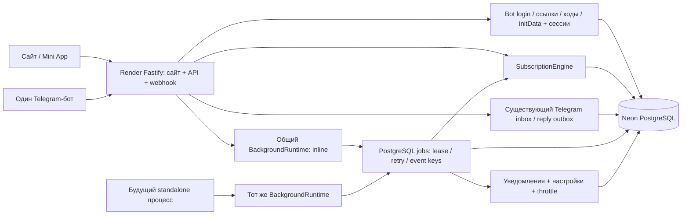

# Архитектура Stage 1.3

Stage 1.3 расширяет опубликованный Stage 1.2.5. Fastify, Prisma, PostgreSQL, Vite и один Telegram-бот сохранены. Новые возможности находятся в ветке разработки до согласованного выпуска.

Сайт и webhook вызывают один SubscriptionEngine с проверенной identity. В браузере нет своей модели пользователей, заказов или серверов. Тема остаётся единственным localStorage состоянием; сессии HttpOnly/Secure/Lax, в базе только хеш случайного токена. Вход через подтверждение в боте, одноразовую ссылку, код и проверенный initData сохранён из Stage 1.2.5; OAuth popup для основного входа не нужен.

order() фиксирует заказ и TEST-платёж. Подтверждение платежа, изменение заказа и FULFILL_ORDER outbox записываются одной транзакцией. Прямой fulfill() сохраняет прежний быстрый ответ API; повтор из очереди обнаруживает завершённый заказ. RECOVER обходит PAID-заказы пакетами и восстанавливает пропущенный outbox. engine.tick() использует эту же очередь.

Распределение мест и изменение сроков сериализует transaction advisory lock 12002026, совместимый с transaction pooling. Прежние SQL RESTRICT, partial unique и ограничения вместимости сохранены. Mock provider детерминированно возвращает виртуальный идентификатор; настоящих сетевых операций аренды под блокировкой нет. Цена, период, вместимость и стоимость читаются из существующих данных, не перезаписываются Stage 1.3.

Активное продление увеличивает срок той же подписки. Продление истёкшей подписки создаёт новую запись с сохранением истории. Аренда виртуального VPS покрывает активные подписки; пустой VPS сохраняется для повторного использования. Истечение, активация и продление ставят нужные уведомления в той же транзакции, что бизнес-изменения.

telegram_updates остаётся единственным durable inbox/reply outbox. background_jobs содержит активацию, lifecycle, recovery, cleanup и уведомления. Это разные виды работы, а не вторая очередь тех же Telegram updates. Потребители используют FOR UPDATE SKIP LOCKED, lease token и серверное время PostgreSQL; event key уникален. Транзакции не удерживаются во время Bot API запроса. После неопределённой доставки сообщение карантинируется. Сбой записи подтверждения после успешного send также сохраняет неопределённость, а не запускает повторную отправку.

На Render Free runtime работает внутри API. Сон останавливает обработку; пробуждение выполняет актуальную сверку и due-задачи. Подготовленный apps/worker использует тот же код и базу без polling и регистрации webhook. Для переноса API получает BACKGROUND_MODE=external; новый сервис автоматически не создаётся.

Административные списки отделены от агрегатов: cursor по (createdAt,id), максимум 50 записей, только фиксированные серверные select/filter. Пользовательские списки ограничены владельцем. Диагностика и повтор задач доступны ADMIN; delivery-unknown retry запрещён. Публичные health endpoints не раскрывают очередь, identities и настройки.

Подробности: [очередь и worker](stage-1.3.md), [пагинация](pagination-stage1.3.md), [защита данных](backup-recovery.md), [облачный выпуск](cloud-deployment.md).
