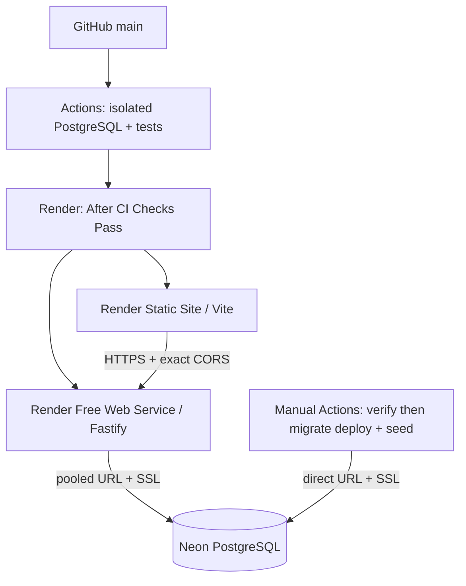

> Исторический документ Stage 1.1/1.1.1. Для Stage 1.2 используйте [облачную инструкцию](cloud-deployment.md), [архитектуру](architecture.md) и [актуальные проверки](verification-stage1.2.md).

# Cloud architecture — Stage 1.1.1

Stage 1.1 сохранён. Ни одна таблица, старая миграция, SQL CHECK, индекс или триггер не менялись. MockServerProvider, bot, worker и темы сохранены. В Render запускаются только API и статический сайт; polling и постоянные фоновые процессы не включены в бесплатную схему.

## Runtime

Render передаёт `PORT`; конфигурация отдаёт ему приоритет над `API_PORT`. При production или заданном PORT host по умолчанию `0.0.0.0`, локально остаются 127.0.0.1:3000. Blueprint явно задаёт host, не фиксируя порт. Существующее закрытие Fastify/Prisma при SIGTERM сохранено. Runtime удалённой production-БД требует sslmode=require либо verify-full. Production CORS требует явных HTTPS origins.

`/health` — проверка HTTP-сервера и health check Render. Он не требует обращения к Neon, поэтому штатный мониторинг не заставляет базу постоянно выполнять запросы. `/ready` остаётся отдельной реальной проверкой PostgreSQL: при сбое безопасный 503. `/plans` читает ту же БД и тоже безопасно сообщает отказ. Временный отказ Neon не подменяется успешным статусом БД.

## Build

Корень сборки — корень monorepo. Node закреплён одновременно .nvmrc и NODE_VERSION; pnpm — packageManager. Установка содержит devDependencies (`--prod=false`), необходимые TypeScript, Prisma CLI и Vite.

`build:cloud:api` собирает только API и его workspace-зависимости, включая Prisma generate. `build:cloud:web` собирает shared и web в production-режиме; обязательный публичный HTTPS origin API проверяется до сборки и встраивается константой. В клиент нет импорта runtime/database и нет секретов БД. Обычный `build` сохраняет локальную сборку сайта (`mode=development`); её нельзя публиковать вместо cloud-команды. CSS, theme и страницы остались прежними. Ручная повторная проверка после холодного старта обновляет также тариф, без фонового keep-alive.

## Миграции и доверие

Обычный verify workflow использует только временную PostgreSQL из service container. Neon secret в него не передаётся. Отдельный cloud-database workflow запускается вручную, сначала вызывает тот же verify, затем работает только с коммитом основной ветки. Он последовательно выполняет migrate deploy и идемпотентный seed через direct URL. Одновременные запуски этого workflow сериализованы; текущая миграция не отменяется новым запуском. Строка подключения хранится в repository secret и появляется только в последнем шаге.

Отдельная direct-строка нужна для DDL-операций Prisma; pooled URL обслуживает runtime. Prisma schema не меняется: cloud-скрипт передаёт direct URL как DATABASE_URL только своим дочерним процессам. Поэтому не нужен directUrl в схеме и новая миграция ради облачной настройки. Скрипт принимает только SSL-enabled direct Neon endpoint и не печатает исходные ошибки драйвера, способные содержать фрагменты секрета.

Это ручной процесс миграций, не автоматическое применение БД при каждом push. При обновлении схемы оператор сначала отключает автодеплой, загружает полный коммит, проверяет CI, выполняет миграцию, затем публикует. Старт API, обработчики HTTP и Render build не изменяют БД.

`checksPass` защищает автоматические деплои обычных коммитов после настройки интеграции. Blueprint Auto Sync необходимо выключить отдельно; ручной деплой/синхронизация/первоначальное создание остаются действиями оператора. Нет обещания принудительного запрета любого ручного обхода владельцем аккаунта.

## Публичная демоверсия

Только GET health/ready/system/plans. Нет маршрутов создания заказа, оплаты, аренды или админ-операций; admin frontend — прежняя информационная страница. CORS ограничивает браузерные origins, но не считается авторизацией. Не добавлены фиктивные токены доступа, debug endpoints или реальные платные адаптеры. Данные находятся в Neon, не на временной файловой системе Render. Перезапуск API не запускает reset или seed.

Официальные сведения и границы бесплатных тарифов приведены в cloud-deployment.md. Нагрузки, настоящее облачное восстановление и эксплуатация не проверены; это демоверсия.
